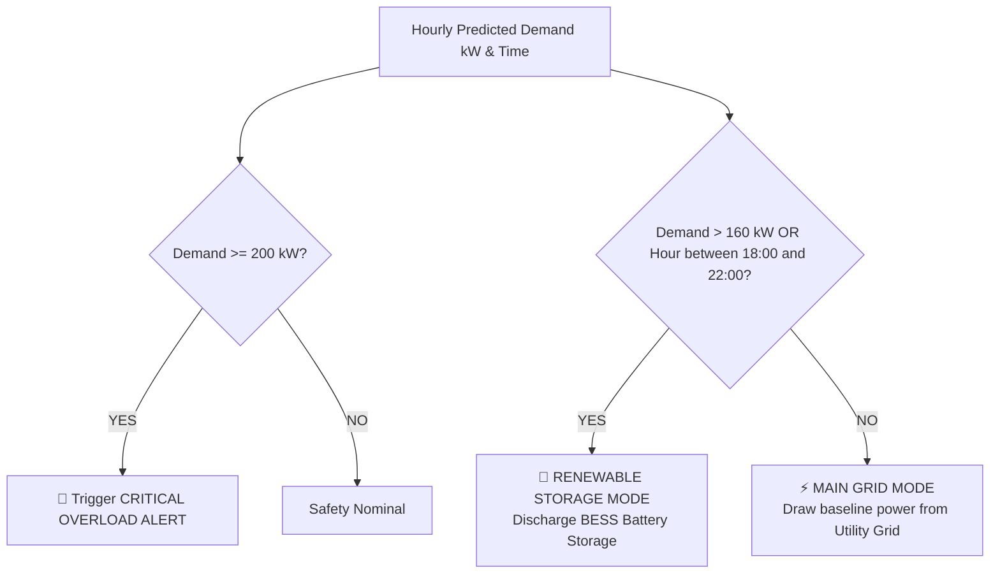

# ⚡ SmartGrid AI
### Autonomous Microgrid Orchestrator & Demand Forecast Control
**Built for the HackSphere 3.0 Smart Energy Microgrid Challenge**


---

## 📌 Project Overview
**SmartGrid AI** is an intelligent microgrid management and energy dispatch system designed to balance municipal utility grid reliance with local battery energy storage (BESS) and renewable sources.

The system ingests 24-hour electricity demand forecasts, evaluates autonomous switching rules to mitigate peak stress on utility infrastructure, continuously tracks battery State-of-Charge (SoC), and triggers independent critical overload alerts.

---

## ⚙️ Microgrid Switching Rules & Logic
SmartGrid AI enforces the exact deterministic switching rules specified in the HackSphere 3.0 problem statement:



1. **Renewable Storage Mode Trigger**:
   - If **predicted demand is greater than 160 kW** **`OR`**
   - The **time is between 18:00 and 22:00 inclusive** (`18 <= hour <= 22`),
   - **Action**: Switch to **Renewable Storage Mode** (discharging battery energy storage to perform peak shaving and reduce utility grid strain).

2. **Main Grid Mode**:
   - In all other off-peak and nominal demand conditions, the microgrid switches to **Main Grid Mode** (drawing baseline power from the primary utility grid while floating/charging BESS).

3. **Critical Overload Alert Trigger**:
   - If **predicted demand is at least 200 kW** (`demand >= 200.0 kW`),
   - **Action**: Independently trigger a **Critical Overload Alert** with emergency mitigation directives (secondary inverter engagement and non-essential load shedding).

---

## 🧪 Notice Regarding Mock Prediction Data
> **HackSphere 3.0 Compliance**:
> As specified in the challenge requirements, this build operates using **clearly labelled mock prediction data**. 
> - The AI forecasting engine and Zoho Catalyst cloud functions are **not** falsely claimed to be live.
> - The dashboard features transparent badges and an **Architecture Roadmap modal** clarifying that realistic mock datasets are currently utilized to validate switching mechanics and safety interrupts.
> - The architecture is designed with clean modular interfaces ready to drop in trained LSTM/XGBoost models and Zoho Catalyst serverless endpoints in the subsequent production deployment phase.

---

## 🌟 Key Features
- **24-Hour Electricity Demand Forecast Chart**: Interactive Recharts curve from 00:00 to 23:00 with reference lines at 160 kW (Switching Limit) and 200 kW (Critical Overload) + evening peak window shading.
- **Microgrid Mode Switch Visualizer**: Real-time power routing diagram connecting the Utility Grid, BESS, and Microgrid Controller with live condition checks.
- **Battery State-of-Charge (SoC) Indicator**: High-tech battery widget visualizing percentage, usable energy (kWh out of 500 kWh capacity), charge/discharge flow, and health metrics.
- **Critical Overload Alerts Center**: Dedicated feed tracking all hourly overload events exceeding 200 kW with excess capacity metrics and mitigation protocols.
- **24-Hour Timeline Scrubber & Simulation**: Interactive scrubber slider and **Play 24h Simulation** mode that automatically advances through the day so evaluators can watch real-time switching in action.
- **CSV Upload Interface**: Drag-and-drop CSV uploader with schema verification and an instant sample CSV download feature.

---

## 📁 Repository Structure
```
Smart Energy Microgrid/
├── backend/
│   ├── app/
│   │   ├── main.py              # FastAPI server instance and CORS setup
│   │   ├── models.py            # Pydantic data schemas
│   │   ├── routers/
│   │   │   ├── forecast.py      # /api/forecast/mock & /api/forecast/evaluate
│   │   │   └── upload.py        # /api/upload/csv & /api/upload/template
│   │   └── services/
│   │       ├── mock_engine.py   # Labelled 24h mock demand & solar profile
│   │       ├── rule_engine.py   # HackSphere 3.0 switching & overload logic
│   │       └── csv_service.py   # CSV parsing, validation & calculation
│   ├── requirements.txt         # FastAPI, Uvicorn, Pydantic, Pandas
│   ├── run.py                   # Backend entrypoint runner
│   └── venv/                    # Python virtual environment
│
├── frontend/
│   ├── src/
│   │   ├── components/
│   │   │   ├── Header.jsx                # Brand banner, badges, sample CSV
│   │   │   ├── ArchitectureDisclaimer.jsx# HackSphere 3.0 mock data disclosure
│   │   │   ├── MetricCards.jsx           # Active mode, demand, battery SoC
│   │   │   ├── ForecastChart.jsx         # 24h demand chart with thresholds
│   │   │   ├── ModeSwitchVisualizer.jsx  # Microgrid routing & logic matrix
│   │   │   ├── BatteryGauge.jsx          # Battery SoC cell widget
│   │   │   ├── OverloadAlerts.jsx        # Critical overload events & warnings
│   │   │   ├── TimeSlider.jsx            # 24h timeline scrubber & simulator
│   │   │   └── CsvUploadModal.jsx        # CSV drag-and-drop uploader
│   │   ├── services/
│   │   │   └── api.js                   # API client with offline fallback
│   │   ├── utils/
│   │   │   └── rules.js                 # Rule evaluation helpers
│   │   ├── App.jsx                      # Main dashboard assembly
│   │   ├── index.css                    # Modern cyber-energy dark theme
│   │   └── main.jsx
│   ├── package.json
│   └── vite.config.js
│
├── sample_data/
│   ├── forecast_normal_day.csv          # Standard 24h demand curve
│   └── forecast_heatwave_overload.csv   # High-stress curve with >200kW spikes
└── README.md
```

---

## 🚀 Setup & Installation Instructions

### Prerequisites
- **Python**: Version 3.10+ (tested on Python 3.12)
- **Node.js**: Version 18+ (tested on Node 24.14)
- **npm**: Version 9+

---

### 1. Backend Setup (FastAPI)

1. Open PowerShell or Terminal and navigate to the project directory:
   ```powershell
   cd "c:\Users\Joshi\OneDrive\Desktop\Smart Energy Microgrid"
   ```

2. Activate the existing Python virtual environment (or create one):
   ```powershell
   # On Windows (PowerShell):
   .\backend\venv\Scripts\Activate.ps1
   
   # Or create new:
   python -m venv backend/venv
   .\backend\venv\Scripts\Activate.ps1
   pip install -r backend/requirements.txt
   ```

3. Launch the FastAPI backend server:
   ```powershell
   python backend/run.py
   ```
   *The backend will start at: **`http://127.0.0.1:8000`***
   - Interactive Swagger API Docs: **`http://127.0.0.1:8000/docs`**
   - Healthcheck: **`http://127.0.0.1:8000/api/health`**

---

### 2. Frontend Setup (React + Vite)

1. In a second terminal window, navigate to the `frontend/` folder:
   ```powershell
   cd "c:\Users\Joshi\OneDrive\Desktop\Smart Energy Microgrid\frontend"
   ```

2. Install npm dependencies (if not already installed):
   ```powershell
   npm install
   ```

3. Start the Vite development server:
   ```powershell
   npm run dev
   ```
   *The frontend dashboard will be live at: **`http://localhost:5173`***

---

## 🧪 Testing with Custom CSV Datasets
You can test the CSV upload interface using the bundled test files in `sample_data/`:
1. Click **"Upload CSV Forecast"** in the top header.
2. Drag and drop `sample_data/forecast_heatwave_overload.csv` into the modal.
3. Click **"Import & Run Microgrid Rules"**.
4. Observe the dashboard dynamically update:
   - Peak demand updates to **228.6 kW**.
   - Multiple critical overload alerts trigger for hours **19:00, 20:00, and 21:00**.
   - Battery SoC automatically adjusts to high discharge rates.

Alternatively, click **"Sample CSV"** in the header to download the template file directly.

---

## 📡 REST API Reference

| Endpoint | Method | Description |
| :--- | :--- | :--- |
| `/api/forecast/mock` | `GET` | Returns 24-hour mock demand curve with evaluated switching rules and alerts |
| `/api/forecast/evaluate` | `POST` | Evaluates microgrid rules for any arbitrary hour and kW demand value |
| `/api/upload/csv` | `POST` | Accepts multipart CSV file and returns evaluated 24h microgrid forecast |
| `/api/upload/template` | `GET` | Downloads standard sample CSV template |
| `/api/health` | `GET` | Microgrid orchestrator health check |

---

## 👥 Hackathon Team
- **Project**: SmartGrid AI
- **Event**: HackSphere 3.0
- **Challenge Track**: Smart Energy Microgrid Challenge
